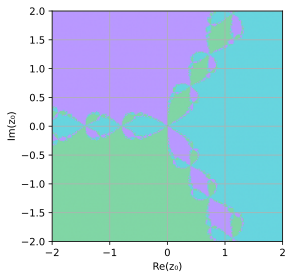
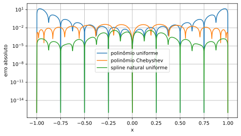
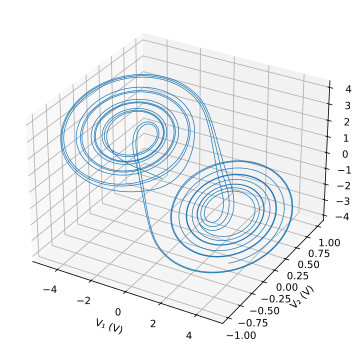

# Galeria de resultados

Todas as figuras abaixo foram produzidas pelo código dos notebooks de estudo. Não são imagens históricas extraídas do material da disciplina.

| Tema | Figuras |
| --- | --- |
| Python | [Função amostrada](figuras/01_python.svg) |
| Newton | [Convergência](figuras/02_convergencia.svg), [bacias complexas](figuras/02_bacias.svg) |
| Ponto flutuante | [Cancelamento e racionalização](figuras/03_cancelamento.svg) |
| Fourier | [Espectro](figuras/04_espectro.svg), [aliasing](figuras/04_aliasing.svg) |
| Interpolação | [Runge](figuras/05_runge.svg), [erros](figuras/05_erros.svg) |
| EDO | [Ordens](figuras/06_ordens.svg), [estabilidade](figuras/06_estabilidade.svg), [pêndulo](figuras/06_pendulo.svg) |
| Chua | [Retrato de fase](figuras/06_chua.svg), [resistências](figuras/06_resistencias.svg) |
| GPS | [Erro de posição sintético](figuras/07_gps_erro.svg) |

## Exemplos

Os gráficos devem ser lidos com as unidades, parâmetros, critérios e limites dos notebooks correspondentes. Aparência visual não substitui uma medida de erro ou uma análise de estabilidade.
