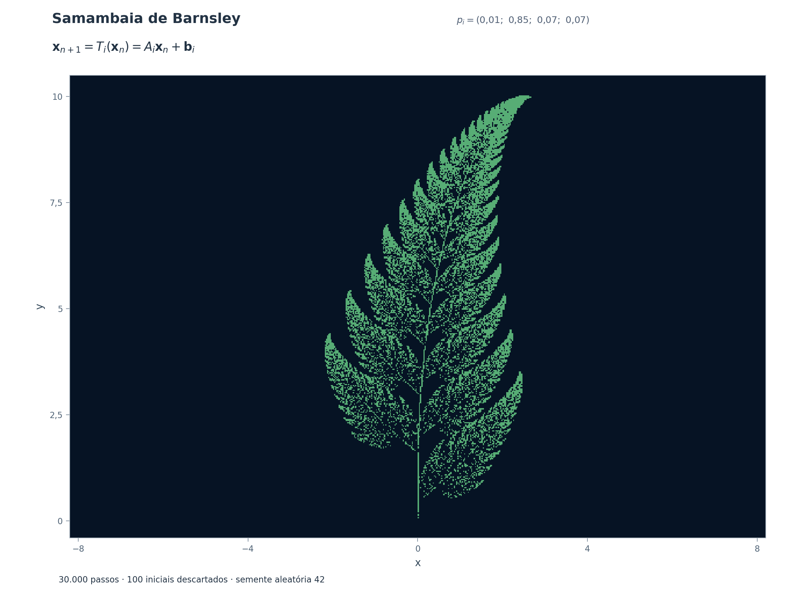
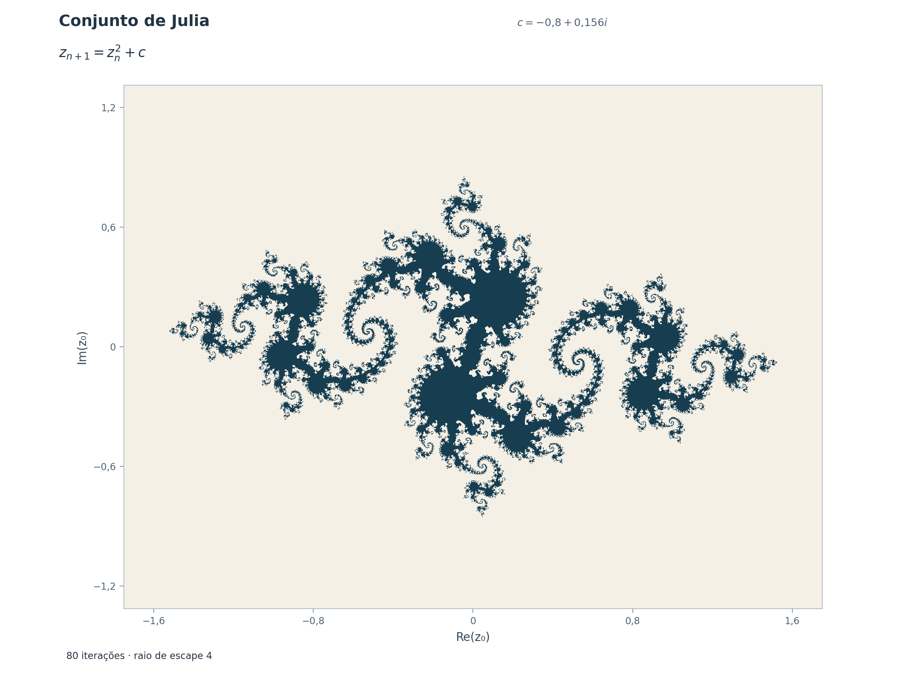
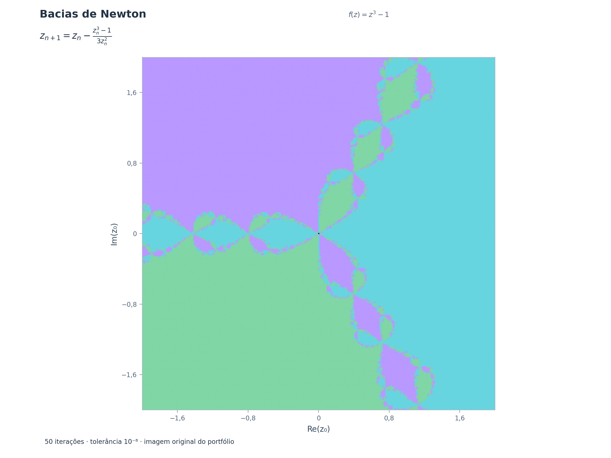
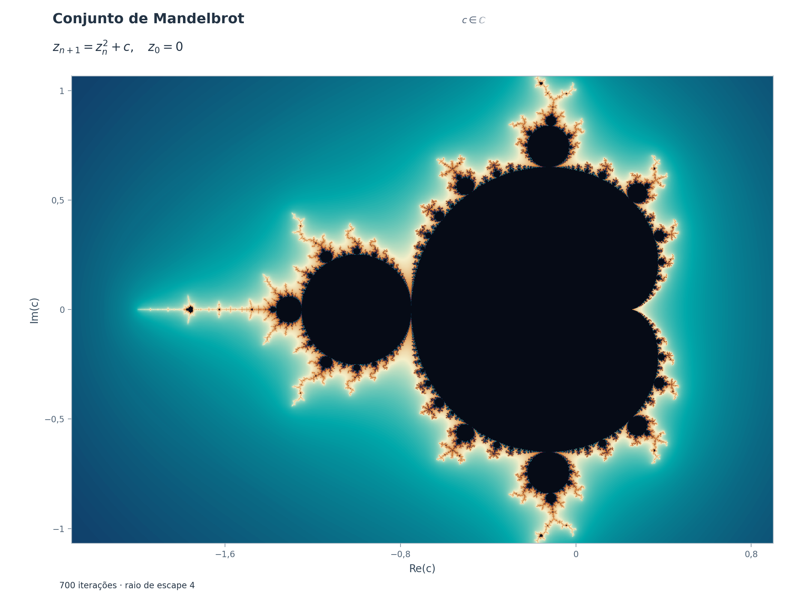

# Galeria de fractais

[README principal](../../README.md) · [Guia do notebook](../../docs/FRACTAIS.md)

Cinco imagens numéricas aprovadas para apresentação, com título, fórmula e eixos padronizados. A ordem editorial é Barnsley, Julia, Newton, Burning Ship e Mandelbrot. Os PNGs são os arquivos aprovados, preservados sem recompressão ou recorte adicional. O manifesto registra suas dimensões e SHA-256.

## Origem e parâmetros

Esta galeria combina resultados de versões diferentes. **Não é uma exportação uniforme do notebook 08 atual** e não substitui suas saídas nem os documentos do acervo acadêmico.

| Imagem | Origem e parâmetros da figura |
| --- | --- |
| Barnsley | Versão simplificada: 30.000 passos, descarte dos 100 iniciais, semente aleatória 42; probabilidades 0,01 / 0,85 / 0,07 / 0,07. Verde sólido. |
| Julia | Recorte essencial aprovado: c = −0,8 + 0,156i, 80 iterações, raio de escape 4; janela [−1,75; 1,75] × [−1,3125; 1,3125]. Azul sólido sobre fundo claro. |
| Newton | Raster da figura original `assets/figuras/02_bacias.svg`, também apresentada no portfólio; z³ − 1, até 50 iterações, tolerância 10⁻⁸. A grade vetorial sobreposta foi retirada e os eixos reapresentados. Não é a nova renderização do notebook 08. |
| Burning Ship | Primeira versão calculada, detalhe [−1,82; −1,70] × [−0,09; −0,01], 700 iterações, raio de escape 4; degradê por tempo de escape suavizado. |
| Mandelbrot | Primeira versão calculada, janela [−2,3; 0,9] × [−1,067; 1,067], 700 iterações, raio de escape 4; degradê por tempo de escape suavizado. |

O notebook 08 permanece didático: 80 iterações de escape e 30 passos de Newton. Reexecutá-lo não reproduz exatamente todos os PNGs desta seleção. O notebook 02 e a figura SVG original permanecem preservados. As imagens são aproximações em malhas finitas; pontos sem escape no limite não têm pertencimento ao conjunto certificado.

## Imagens

### Samambaia de Barnsley

### Conjunto de Julia

### Bacias de Newton

### Burning Ship

### Conjunto de Mandelbrot

